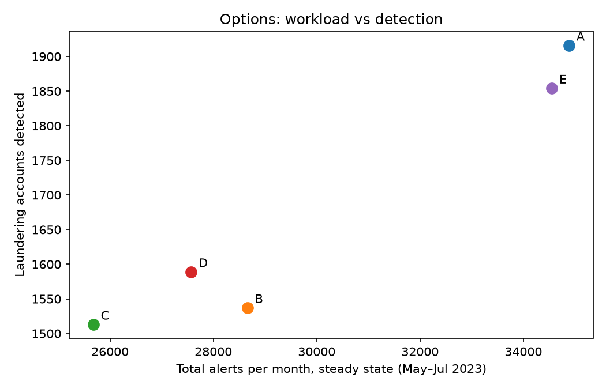

# Transaction monitoring rule review: decision proposal

I simulated a typical request to a transaction monitoring team: investigators say one detection scenario creates too many alerts, and compliance wants to know what would be lost if it were changed. I worked through it the way an analytics translator would, from clarifying the question to a decision proposal and a release checklist, using a public synthetic anti-money-laundering dataset (9.5 million transactions).

The main things I found:

- Three common rule-based scenarios together produce about 35,000 alerts a month by mid-2023 and find 24% of the accounts involved in laundering. The scenario under review, rapid pass-through, sends 13,800 alerts a month, and only 1.3% of them are real.
- Raising its thresholds does not help. None of the 26 settings I tested cut alerts by 30% without losing at least 4.8 points of detection.
- What separates real from false alerts is how the money moves, not how much: weeks with a cash deposit or a cross-border payment are far more often laundering. Using that halves the scenario's alerts, but loses laundering that only uses domestic transfers.
- Only one option meets all the agreed criteria. It combines that change with a longer history window for the structuring scenario. Detection stays almost the same and alerts get better, but total workload hardly changes. The alternative saves about 20 investigators' worth of work but finds about 330 fewer laundering accounts.

That makes it a decision for compliance and the investigations team rather than an analytical question. The decision proposal sets out both options and recommends one.



## Documents

1. [Requirements note](docs/01_requirements_note.md): the request, stakeholders, definitions, success criteria and open questions.
2. [Decision proposal](docs/02_decision_proposal.md): the options, the trade-off, a recommendation and the implementation steps.
3. [Release sign-off checklist](docs/03_release_signoff.md): what has to be true before and after go-live.
4. [Findings log](docs/04_findings_log.csv): 11 data, specification and method issues with owner, action and status. Two of them changed the analysis along the way: the structuring scenario had to look at receiving accounts over six months, and my first definition of a "true alert" favoured one option, so I changed it and re-ran everything.

## Analysis

- [01 Data profile](notebooks/01_data_profile.ipynb): what is in the data, laundering types and their normal look-alikes, data quality.
- [02 Baseline rules](notebooks/02_baseline_rules.ipynb): the three scenarios at current thresholds, detection by laundering type, overlap, sources of false alerts, hand checks.
- [03 Threshold options](notebooks/03_threshold_options.ipynb): 26 threshold settings, five options, stability over time and workload.

The scenarios are written in SQL ([sql/03_rules.sql](sql/03_rules.sql)) and run with DuckDB; Python is used only to run them and summarise the results.

## Running it

```bash
python -m venv .venv && source .venv/bin/activate
pip install -r requirements.txt
kaggle datasets download berkanoztas/synthetic-transaction-monitoring-dataset-aml -p data/raw
```

Then run the notebooks in order. The first run converts the CSV to parquet (under a minute); each rule run takes a few seconds.

## Limitations

- The data is synthetic, so every number shows how such a review works, not what a real bank would see.
- Thresholds, review time per alert and the definition of a true alert are my own assumptions, written down in the requirements note.
- I played both the analyst and the translator. In a real team the open questions would go to investigators, AML experts and compliance before any conclusion.

## Data

SAML-D synthetic transaction monitoring dataset by Berkan Oztas et al., from Kaggle (`berkanoztas/synthetic-transaction-monitoring-dataset-aml`), licensed CC BY-NC-SA 4.0. The data is not included in this repository.

Savelii Seliaev · [LinkedIn](https://www.linkedin.com/in/savelii-seliaev/)
